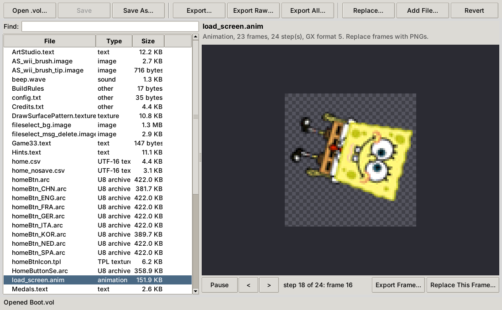
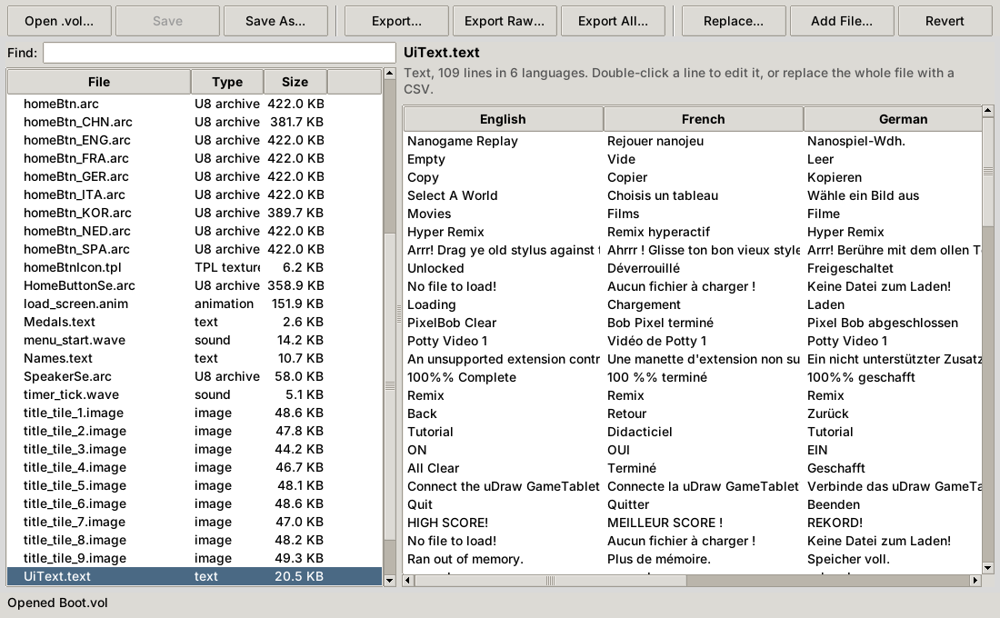

# VolKit

Open up the `.vol` archives of *SpongeBob SquigglePants* (Wii), see what's inside, change it and put it back.

- **VolKit**, a window app: browse an archive, see pictures, play animations and sounds, read and edit the game's text in every language, swap in your own files, and save.
- **VolExtractor** (`wiivol.py`): unpacks whole archives into files you can open: PNG pictures, animated GIFs, WAV sounds and CSV spreadsheets of the text.
- **VolPacker** (`volpack.py`): packs your edits back into a working `.vol`, converting PNG, CSV and WAV files into the game's own formats.

Part of the [*SpongeBob SquigglePants+*](https://sbsp-plus.wubbzp.com/) project. It's the same code the patch's own tools use to read and rebuild the game's files.

**No game files are included.** You need your own copy of the game.

<p align="center"> </p>

## Which Games It Works With

It's made for, and tested with, *SpongeBob SquigglePants* on the Wii (US, `SS8E78`). The game was built with EngineBlack, the engine behind many of WayForward's games, and other games built with it may use some of the same formats, but none have been tested. Not all of them use `.vol` archives: *Batman: The Brave and the Bold - The Videogame* on the Wii, for one, doesn't. The 3DS and DS versions of EngineBlack's games would also store their numbers in the opposite byte order and use different image and sound formats, so they'd need changes to the code.

## Getting Started

You need [Python 3.8 or newer](https://www.python.org/downloads/). On Windows, tick "Add python.exe to PATH" when installing. The launchers install the one package it needs, [Pillow](https://pypi.org/project/pillow/), the first time.

The window app also needs Tkinter, which comes with Python from python.org on Windows and Mac. On Linux, install it with your package manager (for example `sudo apt install python3-tk`).

Then get the archives off the game disc. In [Dolphin](https://dolphin-emu.org/): right-click the game, choose **Properties**, then **Filesystem**, then right-click the files or folders you want and extract them. On a Wii, back up your disc with CleanRip first and open the backup in Dolphin.

**Keep a copy of the original archives.** VolKit never changes a file until you save, but the game needs its own files to run, and VolPacker needs them to pack your edits.

## The VolKit Window

**Windows:** double-click `VolKit.bat`, or drag a `.vol` onto it. **Mac and Linux:** run `./volkit.sh` (or `./volkit.sh Boot.vol`).

- Pick a file on the left to see it on the right. **Find** filters the list by name.
- **Pictures** are shown on a checkerboard, so you can see their see-through parts. **Animations** play with the game's own timing and positions; step through them with **<** and **>**.
- **Text:** double-click a line to edit it in all six languages at once. The change is made straight away.
- **Sounds:** **Play** them, or export them as WAV.
- **Replace...** swaps the picked file for one of yours, converted on the spot: a PNG for a picture, a CSV for text, a WAV for a sound, or any file to use as it is. For animations, use **Replace This Frame...** under the preview.
- **Add File...** puts a new file in the archive. **Revert** undoes the changes to the picked files.
- **Export...** saves the picked files in an easy-to-open format; **Export Raw...** saves them exactly as stored; **Export All...** unpacks the whole archive the way VolExtractor does.
- **Save** or **Save As...** writes the archive. Changed files are shown in orange and added ones in green until then.

Encoding a long sound takes a while (about 20 seconds for 30 seconds of stereo); the window stays usable and shows a progress bar.

## Unpacking Everything: VolExtractor

**Windows:** put the `.vol` files (or folders of them) in this folder and double-click `extract_all.bat`, or drag files and folders onto it. **Mac and Linux:**

```sh
./extract_all.sh                     # every .vol in this folder and its subfolders
./extract_all.sh ~/SquigglePants     # or the files and folders you name
```

Each archive is unpacked into a `<name>_extracted` folder next to it:

```
Boot_extracted/
  raw/         every file exactly as stored in the archive
  converted/   the same files, converted where the format is known
```

| In the game | Converted to |
| --- | --- |
| `.image` (WIMG), `.texture` (WTEX), `.tpl` | PNG, with transparency |
| `.anim` (WANM) | One PNG per frame, plus an animated GIF |
| `.text` (TXTS) | CSV, one column per language (English, French, German, Italian, Dutch, Spanish) |
| `.font` (FONT) | A PNG sheet of every letter, plus a CSV of their sizes |
| `.wave` (WWAV, DSP-ADPCM) | WAV |
| `.arc` (U8 archives) | Unpacked, and their contents converted too |
| UTF-16 `.cfg` and `.txt` | UTF-8 text |

From the command line: `python3 wiivol.py [file.vol | folder ...] [-o output_folder] [-f]`. With no paths it searches the current folder; `-o` puts every archive's output in `output_folder/<name>/`; `-f` extracts everything again (normally, archives a previous run finished are skipped, and only files that failed are retried).

A whole disc's worth of archives takes a while and a lot of disc space: `Boot.vol` alone becomes about 17 MB.

## Packing Your Edits: VolPacker

1. Unpack an archive with VolExtractor.
2. Edit the files in `converted/`: paint over a PNG, change text in the CSV, swap in a new WAV. To replace a file as it is, or to add a new one, put it in `raw/`.
3. **Windows:** drag the `<name>_extracted` folder onto `pack_all.bat`. **Mac and Linux:** `./pack_all.sh Boot_extracted`.

It writes `<name>_new.vol` next to the folder, and lists what it changed and added. Only files you edited are converted back: everything else keeps its exact bytes, so packing an unedited folder gives back the original archive. It finds the original `.vol` next to the folder, or wherever VolExtractor read it from.

From the command line: `python3 volpack.py Boot_extracted [--vol Boot.vol] [-o Boot.vol] [--all]`. `--vol` names the original archive, `-o` names the new one (it can overwrite the original, so keep a copy), and `--all` checks every converted file, not just the ones changed since unpacking.

| Edit this | And it becomes |
| --- | --- |
| A picture's PNG | The game's `.image` or `.texture`, in the original's GX format. It can be a different size; see-through parts are kept. Textures get their mipmaps made again. |
| An animation's `frame_NN.png` files | The `.anim` with those frames replaced, keeping its timing and positions. (The GIF is only a preview.) |
| A text CSV | The `.text` with your changed lines, in any language. Spreadsheet programs are fine: line breaks are put back the way the game writes them. |
| A sound's WAV | The `.wave`, encoded as Nintendo DSP-ADPCM. Mono or stereo, any sample rate; a sound that looped still loops. |
| A UTF-16 `.cfg` or `.txt` | The same file in UTF-16 again. |

Fonts, `.tpl` textures and U8 (`.arc`) archives don't convert back yet: replace them in `raw/`.

## Playing Your Mod

Test your archives in Dolphin first. Either replace the files in an extracted copy of your disc, or load them with [Riivolution](https://riivolution.github.io/), which works on a real Wii too, without touching the disc. A Riivolution patch for an edited `Boot.vol` looks like this (`riivolution/MyMod.xml` on the SD card, with the archive in `/MyMod/`):

```xml
<wiidisc version="1">
  <id game="SS8E" />
  <options>
    <section name="My Mod">
      <option name="My Mod">
        <choice name="Enabled"><patch id="mymod" /></choice>
      </option>
    </section>
  </options>
  <patch id="mymod">
    <file disc="/Boot.vol" external="/MyMod/Boot.vol" />
  </patch>
</wiidisc>
```

*SpongeBob SquigglePants+* replaces `Boot.vol`, `menus.vol` and `Game305.vol` too. To use your changes with it, open its patched files (from its `SquigglePants` folder) in VolKit instead of the disc's.

## The File Formats

`wiivol.py` and `volpack.py` start with notes on every format they read and write (all big-endian): the DVOL archive and its hash table, WIMG and WTEX images with their run-length coded GX tiles, WANM animations and their sequences, TXTS text, FONT glyph tables and WWAV sounds. They're there for anyone who wants to write their own tools.

The game's own `.brlyt`, `.brlan`, `.brfnt`, `.bwav` and `.mid` files (inside the U8 archives) are standard Nintendo or MIDI formats, so they're copied out as they are.

## Reporting a Problem

If a file fails, the output names it, with the error and the line of the code it came from. Please include those lines when you [open an issue](https://github.com/spongebobsquigglepants/volkit/issues).

## Credits

By Mitch "WubbzP" Bentz, for [*SpongeBob SquigglePants+*](https://sbsp-plus.wubbzp.com/).

<sub>A fan-made tool, not affiliated with or endorsed by Nickelodeon, THQ, WayForward or uDraw. *SpongeBob SquarePants*, *SpongeBob SquigglePants* and all related titles, logos and characters are trademarks of Viacom International Inc.</sub>
